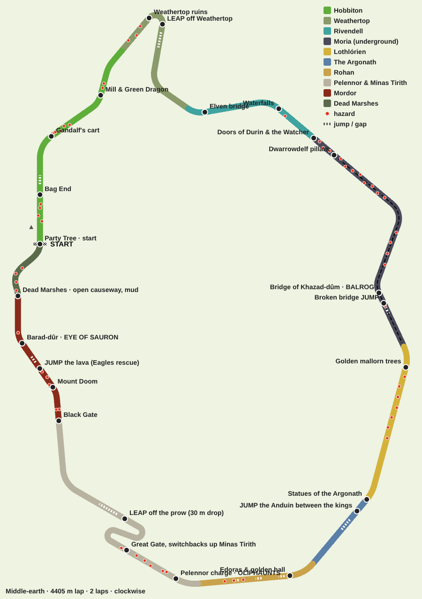

# Middle-earth: the epic map

One 4.4 km circuit through the lands of *The Lord of the Rings*, raced over 2 laps
(about 2.5 minutes a lap). The goal: every few seconds, something on screen should be
unmistakably from the films. Characters appear as scenery and hazards, not racers.

Decisions so far: Lord of the Rings first; a big loop with laps; must-have moments are
Gandalf in Hobbiton, the Balrog on the bridge, the Pelennor charge with Oliphaunts and the
Eye of Sauron. Maps should be ridiculous: big air, brutal corners, lots of movie hazards.

## The lands, in lap order

| Land | Landmarks | Characters | Hazards and stunts |
|---|---|---|---|
| **Hobbiton** (start) | Party Tree and field, Bag End's round green door and "No admittance except on party business" sign, the Mill and double-arched bridge, the Green Dragon inn | Gandalf on his cart, hobbits at the party, sheep | Sheep wandering across, hay bales, Gandalf's cart rolling along the lane, barrels rolling out of the Green Dragon, a jump over the top of Bag End's hill; from lap 2, Gandalf's fireworks burst on the road and the dragon firework swoops overhead |
| **Weathertop** | Amon Sûl's ruined ring of stones on a steep summit | Five Ringwraiths | Climb against charging Nazgûl, a 20 m-radius summit hairpin, then a leap off the summit down the hillside |
| **Rivendell** | Elven halls on the cliffs, autumn trees, waterfalls, the slender bridge | Elves on the terraces | Narrow 10 m bridge with no railings over the gorge, waterfall spray slows you |
| **Moria** (underground) | Doors of Durin glowing in the cliff by the dark lake; the endless pillared halls of Dwarrowdelf; Balin's tomb shaft of light; the Bridge of Khazad-dûm over the chasm | The Watcher in the Water, goblins on the pillars, the Balrog, Gandalf on the bridge ("You shall not pass!") | Tentacles slam the road at the Doors; slalom through the Dwarrowdelf pillars; falling rock; the bridge is 8 m wide with no railings, broken in the middle (jump it), and the Balrog's whip throws you |
| **Lothlórien** | Huge silver-gold mallorn trees, flets and stairs, soft light | Galadriel's light | Mallorn trunks growing in the road |
| **The Argonath** | The two colossal kings raising their hands over the Anduin | — | Jump the river between the statues |
| **Rohan** | Golden plains, Edoras and the golden hall Meduseld on its hill | The Rohirrim riding | Rolling whoops (three small jumps), riders galloping across the road |
| **Pelennor & Minas Tirith** | The white seven-tiered city, the prow, the Great Gate, siege towers, burning fields | Oliphaunts, Rohirrim charge, Nazgûl on fell beasts | Oliphaunts sweeping across the road, catapult boulders smashing down, switchbacks up through the city, then a leap off the prow (30 m drop) back to the fields |
| **Mordor** | The Black Gate, Mount Doom erupting, Barad-dûr and the Eye | Orc armies, the Eye of Sauron | The Black Gate opens and slams shut on a timer, lava bursts, a jump over a lava river (fall in and the Great Eagles rescue you), the Eye's searchlight slows whoever it catches |
| **Dead Marshes** | Misty pools with drowned faces and corpse candles | Gollum | Narrow open causeway, mud |

## Rules that make it work

- **Air**: ramps and gaps are real ballistic flights. Too slow and you fall short.
- **Open edges**: bridges and causeways have no walls. Drive off and you fall.
- **Great Eagles**: falling anywhere means an eagle sets you back on the road, rolling,
  with a proper run-up before the next jump. It costs about two seconds.
- **Hazards** are data: movers sweep across or along the road, strikers flash a warning
  then hit, slow zones drag you down, launchers throw you into the air. AI drivers see
  them and dodge.
- **Atmosphere follows you**: each split-screen view takes the sky, fog and light of the
  land its racer is in, so one player can be in sunny Hobbiton while another is under
  Mordor's red sky.

## Build order

1. Engine: air, gaps, open edges, eagle rescue, hazards, AI dodging. **Done.**
2. Route with all regions, jumps and hazards. **Done.**
3. Per-land atmosphere and road styles; Moria's underground halls.
4. Lands one at a time, each finished with its landmarks, characters and hazard visuals:
   Hobbiton, Moria, Pelennor and Minas Tirith, Mordor first (the four must-have moments),
   then Weathertop, Rivendell, Lothlórien, the Argonath, Rohan and the Dead Marshes.
